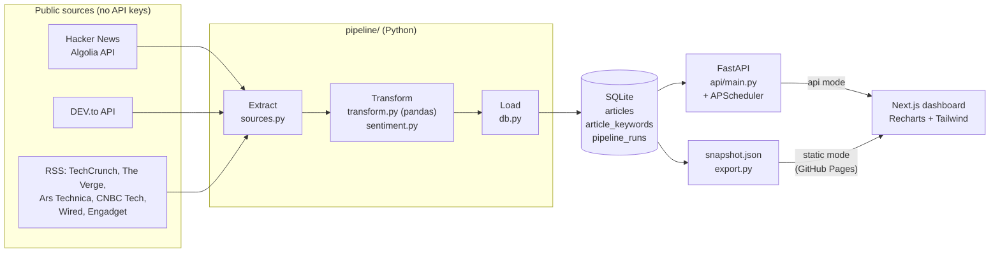

# Tech Trend Sentiment Tracker

An automated data pipeline and analytics dashboard that tracks how the tech and market news cycle *feels*. Every six hours it pulls headlines from Hacker News, DEV.to and six news feeds, cleans and de-duplicates them with pandas, scores each one for sentiment, tags it with a sector and trend keywords, and stores the results in SQLite. A FastAPI backend serves the analytics, and a Next.js dashboard charts sentiment over time, sector breakdowns, trending keywords and the raw data log.

**Live demo:** https://ethanyap123.github.io/trend-sentiment-tracker/

      

## Features

- **Scheduled ETL pipeline** in Python: extract from 8 public sources, transform with pandas, load into SQLite, with every run logged (row counts, duplicates dropped, per-source failures, duration).
- **Lexicon-based sentiment scoring**: the VADER lexicon (about 7,500 rated words) with a tech and markets dictionary layered on top, plus negation, intensifiers and multi-word phrases ("laid off", "all-time high").
- **Sector classification and trend tracking** from keyword dictionaries: 11 sectors and 37 tracked terms (AI agents, Nvidia, Rust, layoffs, funding rounds…).
- **REST API** for historical sentiment, daily time series, sector and keyword breakdowns, the article log and pipeline runs, with filters on every endpoint.
- **Two schedulers**: APScheduler inside the API process for local or server runs, and a GitHub Actions cron that keeps the public demo fresh.
- **Interactive dashboard**: KPI tiles with period-over-period deltas, a sentiment trend with a 7-day volume-weighted average, daily volume by polarity, sector breakdown, a three-way sector comparison, trending keywords with momentum, a searchable paginated data log and the pipeline run history. Filter by date range (7/30/90 days or custom), sector, source and polarity; filters are kept in the URL so views can be shared. Works in light and dark mode and down to phone width.

## Architecture



The dashboard talks to one data interface ([`dashboard/src/lib/data.js`](dashboard/src/lib/data.js)) with two backends:

- **API mode** (local or self-hosted): every query goes to FastAPI, which runs SQL against SQLite.
- **Static mode** (the GitHub Pages demo): the dashboard downloads a column-packed snapshot of every stored article (about 1 MB gzipped) and answers the same queries in the browser with [`analytics.js`](dashboard/src/lib/analytics.js), a port of [`pipeline/analytics.py`](pipeline/analytics.py). A parity test runs both implementations on the same data and fails if any result differs.

## ETL flow

### 1. Extract ([`pipeline/sources.py`](pipeline/sources.py))

| Source | Endpoint | What is pulled |
|---|---|---|
| Hacker News | `hn.algolia.com/api/v1/search_by_date` | Stories with 20+ points, one request per day window; points and comment counts kept as engagement |
| DEV.to | `dev.to/api/articles?top=N` | Most-reacted articles; reactions, comments and tags |
| RSS (6 feeds) | TechCrunch, The Verge, Ars Technica, CNBC Tech, Wired, Engadget | Title, summary, link, publish time |

Requests retry with backoff on timeouts, 429s and 5xx errors. A failing source is logged and skipped, so one dead feed marks the run `partial` instead of failing it. Incremental runs re-read the last 2 days because Hacker News scores keep climbing after a story is posted.

### 2. Transform ([`pipeline/transform.py`](pipeline/transform.py))

All rows go into one pandas DataFrame, then:

1. **Clean**: strip HTML tags and entities, collapse whitespace, cut summaries at 400 characters on a word boundary.
2. **Normalise links**: force https, drop `www.`, tracking parameters (`utm_*`, `fbclid`, `ref`…), fragments and trailing slashes. The article ID is a hash of this canonical URL.
3. **Validate**: drop rows with no title, no link or an unparseable date, and anything dated in the future or older than the 90-day retention window.
4. **De-duplicate**: by canonical URL, then by normalised headline (catches syndicated copies under different links), keeping the copy with the most engagement.
5. **Enrich**: each article gets
   - a **sentiment score** in [−1, 1] ([`sentiment.py`](pipeline/sentiment.py)): sum of word valences, titles weighted 1.5×, a negator in the previous three words flips and dampens a word (×−0.74), an intensifier boosts it, and the total is squashed with `x / √(x² + 15)`. Words that are neutral jargon in tech ("kill", "hack", "fatal", "panic") are removed from the lexicon.
   - a **polarity**: positive ≥ 0.05, negative ≤ −0.05, neutral in between.
   - a **sector**: the dictionary with the most whole-word hits, or "General Tech".
   - **trend keywords**: every tracked term the text mentions.

### 3. Load ([`pipeline/db.py`](pipeline/db.py))

```
articles          id, source, title, summary, url, published_at, published_date,
                  engagement, comments, sector, sentiment, polarity, enrich_version, ...
article_keywords  article_id -> keyword   (many-to-many, cascades on delete)
pipeline_runs     trigger, status, started/finished, fetched, clean, inserted,
                  updated, duplicates, invalid, rescored, pruned, source_counts, errors
```

- **Upserts**: new articles are inserted; ones already stored get fresh engagement numbers and scores.
- **Re-scoring**: each row records the `ENRICH_VERSION` it was scored with. Bumping it after a lexicon or dictionary change re-scores the stored history on the next run, without re-fetching anything.
- **Retention**: articles older than 90 days and runs beyond the latest 500 are pruned.
- **Concurrency**: SQLite runs in WAL mode so the API can read while the pipeline writes, and a lock stops two pipeline runs overlapping.

### 4. Schedule

| Where | How | Interval |
|---|---|---|
| Local / server | APScheduler in the FastAPI process ([`api/main.py`](api/main.py)) | `PIPELINE_INTERVAL_MINUTES`, default 60 |
| Public demo | GitHub Actions cron ([`.github/workflows/pipeline.yml`](.github/workflows/pipeline.yml)) | every 6 hours |

The Actions job restores the database from the `data` branch, runs the pipeline, force-pushes the updated database back as a single commit (so binary history never piles up), exports the snapshot and redeploys Pages. The first run, or a manual run with `backfill_days`, rebuilds history from scratch.

## API

Interactive docs at `/docs` when the server is running. Every analytics endpoint accepts `start` and `end` (`YYYY-MM-DD`, UTC; the default is the latest 30 days with data), `sector`, `polarity` (`positive`, `neutral`, `negative`) and `source`.

| Method | Path | Returns |
|---|---|---|
| GET | `/api/health` | Status and article count |
| GET | `/api/meta` | Date bounds, sectors, sources, latest run |
| GET | `/api/summary` | Count, average sentiment, polarity split, and the same figures for the previous window of equal length |
| GET | `/api/sentiment/timeseries` | Daily average and polarity counts, overall and per sector |
| GET | `/api/sectors` | Volume and sentiment per sector |
| GET | `/api/keywords?limit=15` | Top tracked terms with average sentiment and momentum (later half of the range vs the earlier half) |
| GET | `/api/articles?q=&limit=&offset=` | The data log, newest first, with headline search |
| GET | `/api/pipeline/runs` | Run history with per-source counts and errors |
| GET | `/api/pipeline/schedule` | Scheduler state and next run time |
| POST | `/api/pipeline/run` | Starts a run in the background (409 if one is already running; set `PIPELINE_TOKEN` to require an `X-Pipeline-Token` header) |

## Running locally

Requires Python 3.12 and Node 22.

```bash
python -m venv .venv
.venv\Scripts\activate            # macOS/Linux: source .venv/bin/activate
pip install -r requirements-dev.txt

# First run: pull 90 days of history (about 1-2 minutes)
python -m pipeline.run --backfill 90

# Build the dashboard once; FastAPI serves it from dashboard/out
cd dashboard && npm ci && npm run build && cd ..

uvicorn api.main:app --port 8000
```

Open http://localhost:8000 for the dashboard and http://localhost:8000/docs for the API. The scheduler starts with the server; **Run pipeline now** in the header triggers a run on demand.

For dashboard development with hot reload, keep the API running and use `npm run dev` in `dashboard/` (it points at `http://localhost:8000`). To work on the static Pages build instead, export a snapshot with `python -m pipeline.run --export-only` and run `npm run dev:demo`.

| Variable | Default | Purpose |
|---|---|---|
| `TRACKER_DB` | `data/tracker.db` | SQLite file |
| `SCHEDULER_ENABLED` | `true` | Run the pipeline on a timer inside the API |
| `PIPELINE_INTERVAL_MINUTES` | `60` | Timer interval |
| `PIPELINE_TOKEN` | unset | Require this token to trigger runs over HTTP |
| `CORS_ORIGINS` | `http://localhost:3000` | Comma-separated origins allowed to call the API |

## Tests

```bash
python -m pytest
```

26 tests cover sentiment rules (negation, intensifiers, phrases, tech jargon), cleaning and de-duplication, URL canonicalisation, sector and keyword tagging, idempotent upserts, re-scoring, partial-failure logging, the run lock, every API endpoint and its validation, and the Python/JavaScript parity check. The parity test needs Node on the PATH. CI runs the suite before every pipeline run and deploy.

## Project layout

```
pipeline/          ETL: config, sources (extract), transform, sentiment, db (load),
                   analytics (queries), export (static snapshot), run (CLI + lock)
api/main.py        FastAPI app, scheduler, serves dashboard/out
dashboard/         Next.js 16 static-export dashboard (Recharts, Tailwind 4)
tests/             pytest suite + parity.mjs
.github/workflows/ Scheduled pipeline, database persistence and Pages deploy
```

## Limitations

- Lexicon scoring reads words, not meaning: sarcasm, mixed headlines and domain-specific phrasing ("we hacked the iPhone" at a security contest) can be misjudged. Scores are most useful in aggregate, as trends across hundreds of articles.
- Sector and keyword tags come from dictionaries, so roughly half of Hacker News's long tail lands in "General Tech".
- RSS feeds only expose their latest 10 to 50 items, so their history starts from the first pipeline run; Hacker News and DEV.to are backfilled.
- GitHub pauses scheduled workflows in repositories with no activity for 60 days; re-enable the workflow from the Actions tab if that happens.

## License

MIT
